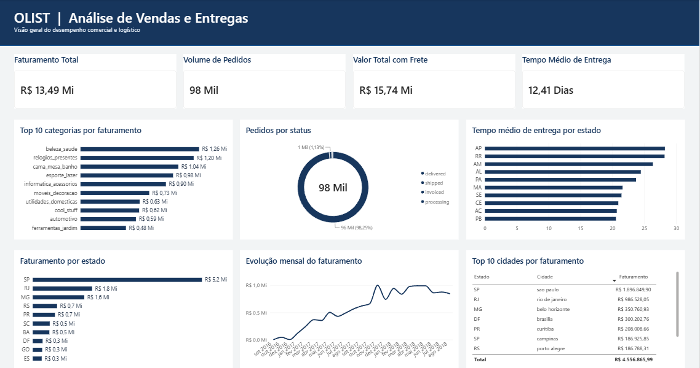
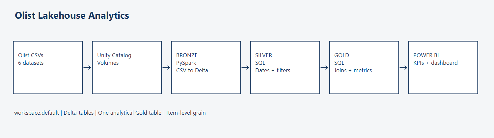

# Olist Lakehouse Analytics

End-to-end Lakehouse analytics project using **Databricks, PySpark, SQL, Delta Lake and Power BI** with a simple Medallion Architecture.

## Project Overview

This project uses the Brazilian Olist e-commerce dataset to practice a complete analytics flow: raw CSV ingestion, Bronze/Silver/Gold organization in Databricks, SQL transformations, and a Power BI analytical layer for sales and delivery analysis.

The implementation is intentionally straightforward and focused on understanding the full data flow rather than simulating a production-scale platform.

## Dashboard Preview




## Architecture



```text
Olist CSVs
    ↓
Unity Catalog Volumes
    ↓
Bronze — PySpark + Delta Lake
    ↓
Silver — SQL
    ↓
Gold — SQL
    ↓
Power BI
```
## Dashboard terminology

The Power BI dashboard was originally created in Portuguese.
For international readers, the main labels are translated below:

| Portuguese | English |
|---|---|
| Faturamento Total | Total Revenue |
| Volume de Pedidos | Order Volume |
| Valor Total com Frete | Total Value Including Freight |
| Tempo Médio de Entrega | Average Delivery Time |
| Top 10 categorias por faturamento | Top 10 Categories by Revenue |
| Pedidos por status | Orders by Status |
| Tempo médio de entrega por estado | Average Delivery Time by State |
| Faturamento por estado | Revenue by State |
| Evolução mensal do faturamento | Monthly Revenue Trend |
| Top 10 cidades por faturamento | Top 10 Cities by Revenue |
| Estado | State |
| Cidade | City |

## Tech Stack

- Databricks
- Unity Catalog Volumes
- PySpark
- Delta Lake
- SQL
- Power BI / PBIP

## Data Pipeline

### Bronze

`src/bronze/01_bronze_ingestion.py` reads six source CSV files from a Unity Catalog Volume. A PySpark loop reads each file with headers and schema inference, removes the `_dataset` suffix from the source name, and writes the result as a Delta table.

The original Databricks notebook used for this step is also included at `notebooks/01_Ingestao_Bronze.ipynb`.

### Silver

`src/silver/02_silver_transformation.sql` applies the main cleaning logic to the orders dataset:

- converts order dates to `TIMESTAMP`;
- retains `delivered`, `shipped`, `invoiced` and `processing` orders;
- exposes the remaining source tables in the Silver layer for analytical use.

The project does **not** claim advanced cleaning on every Silver table; most non-order tables are copied from Bronze as part of this learning implementation.

### Gold

`src/gold/03_gold_analytics.sql` creates `workspace.default.gold_olist_vendas_consolidadas` by joining orders, customers, order items and products.

The table contains customer geography, order status and dates, product category, item price, freight value, total item value including freight, and delivery time in days.

Because an order may contain multiple items, `order_id` can repeat in the Gold table. Order volume is therefore calculated using a distinct count.

## Power BI

The repository includes the Power BI Project format:

```text
powerbi/OlistAnalytics.pbip
powerbi/OlistAnalytics.Report/
powerbi/OlistAnalytics.SemanticModel/
```

The semantic model contains four intentionally simple measures:

| Metric | Definition |
|---|---|
| Faturamento Total | `SUM(valor_produto)` |
| Volume de Pedidos | `DISTINCTCOUNT(order_id)` |
| Valor Total com Frete | `SUM(valor_total_com_frete)` |
| Tempo Médio de Entrega | `AVERAGE(dias_para_entrega)` |

The report definition contains visuals for:

- Top 10 product categories by product value;
- orders by status;
- average delivery time by state;
- product value by state;
- monthly product-value evolution;
- Top 10 cities by product value.

> The public PBIP uses placeholder Databricks connection values. Configure your own Databricks server and SQL Warehouse HTTP path in Power BI before refreshing the model. Credentials are not stored in this repository.

## Repository Structure

```text
.
├── README.md
├── LICENSE
├── architecture/
│   └── medallion_architecture.png
├── data/
│   └── README.md
├── docs/
│   ├── data_dictionary.md
│   ├── project_notes.md
│   └── validation.sql
├── notebooks/
│   └── 01_Ingestao_Bronze.ipynb
├── powerbi/
│   ├── OlistAnalytics.pbip
│   ├── OlistAnalytics.Report/
│   ├── OlistAnalytics.SemanticModel/
│   ├── dax_measures.dax
│   └── ...
├── screenshots/
│   └── powerbi_dashboard.png
└── src/
    ├── bronze/01_bronze_ingestion.py
    ├── silver/02_silver_transformation.sql
    └── gold/03_gold_analytics.sql
```

## How to Reproduce

1. Download the Olist dataset from Kaggle.
2. Upload the six CSV files listed in the Bronze script to `/Volumes/workspace/default/dados_brutos/`.
3. Run the Bronze PySpark ingestion.
4. Run the Silver SQL transformations.
5. Run the Gold SQL transformation.
6. Run `docs/validation.sql`.
7. Open `powerbi/OlistAnalytics.pbip` in Power BI Desktop.
8. Configure your Databricks server and SQL Warehouse HTTP path, authenticate, and refresh.

## Validation

`docs/validation.sql` includes checks for:

- Bronze and Silver table creation;
- order counts by status;
- Gold row count;
- distinct order count;
- product value;
- total value including freight;
- average delivery days.

## Key Learnings

- Ingesting CSV files from Unity Catalog Volumes with PySpark.
- Writing Delta tables in Databricks.
- Separating raw ingestion, basic transformations and analytical joins with Bronze/Silver/Gold layers.
- Understanding why a join with order items can repeat `order_id` and why order volume requires a distinct count.
- Connecting a Databricks analytical table to Power BI.

## Possible Improvements

Future iterations could include:

- explicit schemas instead of `inferSchema`;
- incremental ingestion;
- automated data-quality tests;
- orchestration and monitoring;
- dimensional modeling;
- CI/CD.

These improvements are intentionally outside the scope of the current version.

## Dataset

This project uses the [Brazilian E-Commerce Public Dataset by Olist](https://www.kaggle.com/datasets/olistbr/brazilian-ecommerce). Source CSV files are **not included** in this repository.

## Security

- No Databricks PAT is stored in the repository.
- Databricks workspace/warehouse identifiers are replaced with placeholders in the public PBIP.
- Power BI local caches, local settings and backups are excluded.
- Credentials must be configured locally in Power BI / Databricks.

## License

Project code is available under the MIT License. The Olist dataset remains subject to the license and terms of its original source.
